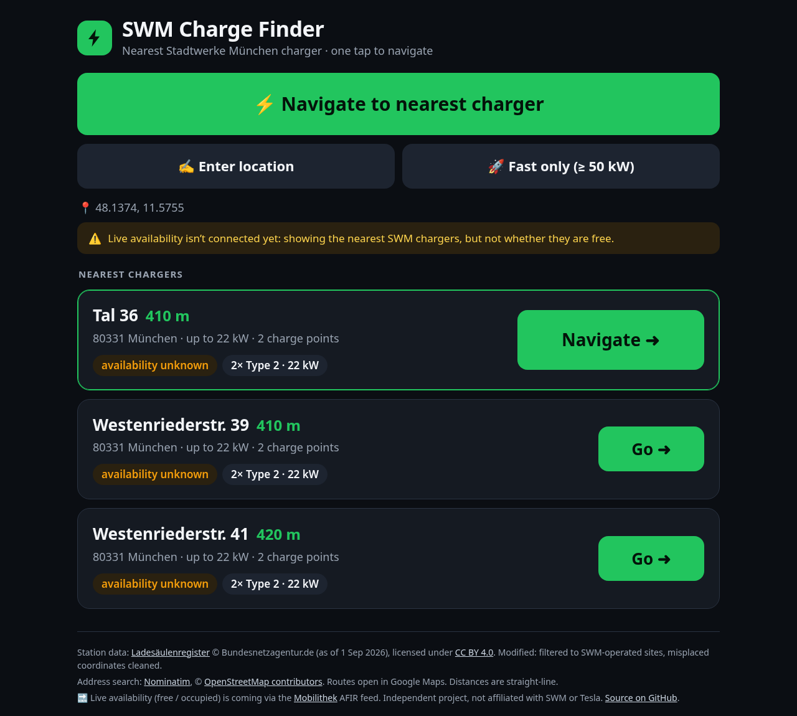

# ⚡ SWM Charge Finder

**Find the nearest SWM (Stadtwerke München) EV charger and start navigating with one tap – built for the Tesla in-car browser.**

[](https://github.com/megatony/swm-charge-finder/actions/workflows/pages.yml)
[](LICENSE)
[](https://creativecommons.org/licenses/by/4.0/)

**Live demo → <https://megatony.github.io/swm-charge-finder/>**



## Features

- **One big button.** "Navigate to nearest charger" reads your position and lists the three closest SWM sites; the top result opens turn-by-turn directions (Google Maps, which hands off to the car's navigation).
- **Made for the car.** Large touch targets, dark theme, a single ~13 KB page plus a ~220 KB station file, and no frameworks, trackers or build step.
- **Useful details.** Each station shows its distance, max power (kW), connector types (Type 2, CCS, CHAdeMO) with counts, and its address.
- **Fast-only filter** for DC chargers at 50 kW or more.
- **Manual location.** Enter an address (OpenStreetMap Nominatim) or `lat, lng` coordinates when GPS is unavailable or denied.
- **Deep links.** `?lat=48.137&lng=11.575` runs a search immediately.
- **Works fully static** (GitHub Pages). An optional zero-dependency Node backend adds **live availability** and a **send-to-car** endpoint.

## How it works

```
Bundesnetzagentur CSV ──► scripts/build-static.py ──► public/stations.json (621 SWM sites, 1,533 charge points)
                                                          │
Browser (public/index.html + core.js) ◄───────────────────┘   ranks by straight-line distance, client-side
        │  tries /api/nearest first, falls back to the static data
        ▼
server.js (optional) ── lib/live.js ──► Mobilithek AFIR dynamic feed (DATEX II v3 / OCPI-style JSON, mTLS)
        │                               → only returns stations with an AVAILABLE charge point
        └── POST /api/send-nearest-to-car ──► Tesla vehicle-command proxy ──► Fleet API navigation_gps_request
```

1. **Static data build.** `scripts/build-static.py` reads the official charging-station register CSV, keeps operational SWM-operated sites, groups charge points by location, and fixes rows that were geocoded to the city centre. Those rows are moved to a twin entry at the same address, or dropped.
2. **Frontend.** `public/core.js` (shared with Node) ranks stations by haversine distance and optional minimum power. On GitHub Pages it all runs in the browser.
3. **Backend (optional).** `server.js` serves the UI and `GET /api/nearest`. With a live source configured, `lib/live.js` fetches the Mobilithek AFIR-Recharging-Dynamic feed. It accepts DATEX II v3 `refillPointStatus` and OCPI-style `{evse_id, status}` records, caches them for 60 s, and keeps only stations that have a free point.
4. **Send to car (planned).** `POST /api/send-nearest-to-car` picks the nearest (free) charger and sends it to the car's navigation through the Tesla Fleet API (`navigation_gps_request`, signed by Tesla's vehicle-command proxy). It hasn't been tested against a real car yet.

## Quick start

Requirements: Node 18+ (no npm dependencies). Python 3 is needed only to rebuild the data.

```bash
git clone https://github.com/megatony/swm-charge-finder.git
cd swm-charge-finder

# Static only: serve public/ with anything
python3 -m http.server -d public 8080        # → http://localhost:8080

# Backend + UI
node server.js                                # → http://localhost:8080 (PORT to change)
curl "http://localhost:8080/api/nearest?lat=48.137&lng=11.575&limit=3&minKw=0"

# Tests
node test/test.js

# Rebuild public/stations.json from a fresh register download
#   CSV: https://www.bundesnetzagentur.de/ladesaeulenkarte → "Liste der Ladesäulen (CSV)"
python3 scripts/build-static.py path/to/Ladesaeulenregister.csv
```

Deployment: every push to `main` runs the tests and publishes `public/` to GitHub Pages via [`.github/workflows/pages.yml`](.github/workflows/pages.yml).

### API

| Endpoint | Description |
|---|---|
| `GET /api/nearest?lat=&lng=&limit=3&minKw=0` | Nearest stations as JSON (`limit` ≤ 10). With a live feed, only stations with an `AVAILABLE` point. |
| `POST /api/send-nearest-to-car?lat=&lng=` | Header `X-Api-Secret` required. Sends the nearest station to the car via Tesla Fleet API. |

## Configuration

All configuration is through environment variables (names only; never commit values):

| Variable | Purpose |
|---|---|
| `PORT` | HTTP port (default `8080`) |
| `LIVE_SOURCE` | `none` (default), `datex2` (Mobilithek), or `file` (local JSON for testing) |
| `MOBILITHEK_URL` | Subscription URL of the Mobilithek AFIR dynamic feed |
| `MOBILITHEK_CERT`, `MOBILITHEK_KEY` | Client certificate and key (PEM paths) for Mobilithek mTLS |
| `MOBILITHEK_PFX`, `MOBILITHEK_PASS` | Alternative: PKCS#12 bundle path and its passphrase |
| `LIVE_FILE` | Path to a downloaded feed when `LIVE_SOURCE=file` |
| `API_SECRET` | Shared secret expected in `X-Api-Secret` for send-to-car |
| `TESLA_PROXY_URL` | Base URL of Tesla's vehicle-command HTTP proxy |
| `TESLA_ACCESS_TOKEN` | Tesla Fleet API user access token |
| `TESLA_VIN` | Target vehicle VIN |

`lib/live.js` also contains `googleNearbyAvailable()`, an unused adapter for the Google Places API (New) `evChargeOptions` that needs your own API key.

## Data sources & attribution

- **Charging stations:** [Ladesäulenregister](https://www.bundesnetzagentur.de/ladesaeulenkarte) © **Bundesnetzagentur.de** (as of 1 September 2026), licensed under [CC BY 4.0](https://creativecommons.org/licenses/by/4.0/). Changes: filtered to SWM-operated sites (SWM Versorgungs GmbH, SWM Mobilität GmbH), regrouped by location, misplaced city-centre coordinates corrected or removed. The Bundesnetzagentur accepts no liability for accuracy or completeness.
- **Address search:** [Nominatim](https://nominatim.openstreetmap.org/), data © [OpenStreetMap contributors](https://www.openstreetmap.org/copyright) (ODbL).
- **Live availability (planned):** [Mobilithek](https://mobilithek.info), the national mobility data platform, through its AFIR recharging dynamic feeds.
- **Routing:** Google Maps directions links.

### Known limitations

- Distances are straight-line, not driving distance.
- Only 324 of the 1,533 register charge points carry an EVSE ID. Full live matching will need the operator's AFIR static feed.

This is an independent hobby project. It isn't affiliated with or endorsed by Stadtwerke München, Tesla, or the Bundesnetzagentur.

## Roadmap

- [x] Static nearest-charger finder on GitHub Pages
- [x] Backend with pluggable live-status adapters (DATEX II / OCPI) and tests
- [ ] **Live availability:** subscribe to the Mobilithek AFIR dynamic feed (registration pending) and show only free chargers
- [ ] AFIR static feed for complete EVSE-ID matching
- [ ] **Voice:** a Siri Shortcut or voice assistant calls `/api/send-nearest-to-car`, and Tesla Fleet API sends the route straight to the car's navigation
- [ ] Driving-distance ranking

## License

Code: [MIT](LICENSE) © 2026 Bahadır Akın Akgül. Station data: CC BY 4.0, Bundesnetzagentur.de.
